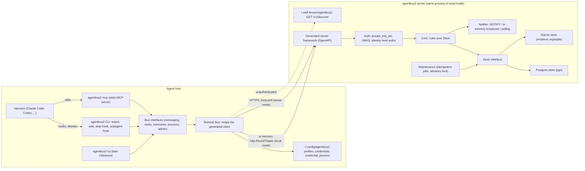

# agentbus2 design

Status: Draft 2026-10-20, transcribed from the design decisions Eric made
on 2026-10-19 (`HANDOFF.md`, Decisions 1 to 63) and on 2026-10-20
(Decisions 64 to 96: the code generator, the answers to Questions 2 to
24, and the second-round answers to Questions 25 to 32,
`.local/review-answers-2026-10-20.md`). Every decision below is
labeled "Decision N (Eric)" (in the section 2.2 table, by a "(Eric)" mark
after the number). Nothing in this document re-decides. Where a 2026-10-20
decision changes an earlier one, the earlier text stands and is marked
"superseded in part by Decision N (Eric, 2026-10-20)". Should applying an
answer open a gap, the text says "Claude proposal, pending Eric" and the
question goes in section 12.1; none is open now. The ADRs in `docs/adr/` record the
architectural decisions; section 11 maps every decision to its section
here and its ADR.

Related: ADR 0001 (transport and API), ADR 0002 (authentication and
credentials), ADR 0003 (identity, sessions and delivery), ADR 0004 (Store
contract and storage), ADR 0005 (no migration from v1; separate product),
ADR 0006 (no direct messages), ADR 0007 (OpenAPI code generator),
ADR 0008 (channel access control lists), and the code-generator spike
`2026-10-19-codegen-spike.md`.

## 1. Purpose and scope

agentbus2 is a breaking redesign of agentbus v1
(`/Users/efitz/Projects/agentbus`, v1.14.3 plus four commits, `v1.14.3-4-g8bb09e2`). The headline feature is a
remote server: a host is configured either for a local shared database or
so that every agent on the host uses a server, and the server can be a
local process with a network endpoint, a Docker container or a real remote
host. Eric's goal is simple, clean code at the end.

### 1.1 In scope for 2.0.0

- An API server over SQLite or Postgres, defined by an OpenAPI schema.
- A generated client, a local stdio MCP server built on it, a CLI, the
  Stop and SubagentStart hooks, `watch` (and `wait`) over long-poll.
- Real authentication (Ed25519 key pairs, OAuth `private_key_jwt`),
  trust-on-first-use registration, enrollment tokens, a default
  authorization policy, per-channel access control lists (Decision 80,
  Eric; section 4.6), an admin API section.
- Messaging, channels, tags and tag subscriptions, subjects, search
  (text and semantic), memories, tasks and task lists, ported from v1.
- A local mode that is the same server code path called in-process.
- The TUI, in a later milestone after the server, client, MCP server and
  hooks are stable (Decision 60, Eric; Milestone 8).
- Release tooling (signing and notarization, Actions release builds,
  Homebrew formula `agentbus2`, `install.sh` and `install.ps1`), ported in
  the final milestone before 2.0.0 (Decision 61, Eric; Milestone 9).

### 1.2 Deferred past 2.0.0

- A WebSocket endpoint behind a capability flag, with a separate AsyncAPI
  definition, meant for Claude Code Monitor's `ws` source (Decision 11,
  Eric).
- AWS workload identity. AWS hosts use key pairs or `credential_process`
  (Decision 63, Eric).
- The shape of the authorization policy beyond channel ACLs; only a
  default policy ships now (Decision 24, Eric; superseded in part by
  Decision 80, Eric, 2026-10-20: per-channel ACLs ship in 2.0.0, so what
  stays deferred is any policy beyond them, for example membership
  decided by policy, Decision 17).

### 1.3 Dropped, not ported

- Direct messages (Decision 13, Eric; ADR 0006). They stay in v1; nothing
  changes on v1 `main`.
- Identity derived from the harness process (Decision 14, Eric).
- `-filter` and @mention addressing (Decision 12, Eric).
- v1 memories and data: v2 starts empty, and v1 keeps running for as long
  as it is installed (Decision 62, Eric). There is no migration path from
  the v1 schema and none between SQLite and Postgres (Decision 29, Eric).

agentbus2 is a separate product in its own public repository, started from
scratch; v1 logic is ported deliberately, and each porting commit names the
v1 source (Decision 31, Eric). Separate names and paths throughout mean
v2 never touches v1 data (Decision 32, Eric).

## 2. Architecture

### 2.1 Modes

Decision 1 (Eric): two modes per host. A host is configured either for a
local shared database (today's model), or so that every agent on the host
uses a server.

Decision 2 (Eric): the server encapsulates its data store. The backends
are SQLite and Postgres; Redis was considered and dropped. (Elaboration,
not part of Decision 2: clients never open the database.)

Decision 35 (Eric): local mode uses the generated API client with an
in-memory `http.RoundTripper` that calls the server handler (over SQLite)
in the same process. One code path, no daemon. When several processes
share one local SQLite database, they poll for wakes. The spike proved the
round-trip shape with a ten-line transport whose `RoundTrip` runs
`ServeHTTP` on a recorder (spike, need 6).

Because the server encapsulates the store, everything that reads or
writes it runs on the server side of the seam, in both modes: rules,
maintenance, embedding and search. Decision 68 (Eric, 2026-10-20): in
local multi-process mode all cross-process state lives in the shared
SQLite database: session rows with leases, a watch registration per
session (the newer watch marks the older one replaced, section 3.5), a
maintenance lease row (section 5.7), and migrations in an immediate
transaction that re-reads `schema_version` (section 5.6). No pidfiles and
no file locks.

### 2.2 Components

| Component | What it is | Decision |
| --- | --- | --- |
| Server | `agentbus2 server`: the generated server framework plus hand-written handlers, auth middleware, notifier and maintenance, over a Store. | 2, 4 |
| Core | The rules, once, over `Store`: rate limits, receipts, delivery, leases, tags, policy and channel ACLs. Never in the client. | 5, 80 (Eric) |
| `Store` | The persistence seam, implemented by the SQLite and Postgres stores. Section 5. | 5, 25 |
| `Bus` | The client-facing seam, split by consumer: for example messaging, tasks, memories, sessions, admin. | 7 (Eric) |
| Generated client | Produced from the OpenAPI schema; wrapped by the remote `Bus` implementation. Generated types never cross the `Bus` interfaces. | 4, 47 |
| Local stdio MCP server | `agentbus2 mcp`, named `agentbus2`, with the client embedded; MCP tool schemas are hand-written. Not a network MCP server (hooks, `wait`, the TUI and identity lookup all need a local binary anyway). | 3 (Eric), 47 |
| CLI | `agentbus2` subcommands for the operator and the hooks. | 33 |
| Hooks | `agentbus2 stop-hook` and the subagent hook; they locate their session by walking the process tree to the harness, never prove identity, and fail open within a few hundred milliseconds. | 31, 41 |
| `watch` and `wait` | The long-poll doorbell clients, with the v1 CLI contract and exit codes. | 10, 42 |
| TUI | Later milestone. | 60 |

Decision 6 (Eric): every method takes a `context.Context`.

Decision 8 (Eric): the server enforces authorization at the identity
level. Authentication and authorization are enforced in server code the
project writes, as hand-written `net/http` middleware (Decision 64,
Eric: oapi-codegen generates no auth code).

### 2.3 Component diagram



### 2.4 Sequence: authenticate, open a session, watch, receive, ack

```mermaid
sequenceDiagram
  participant C as Client (agentbus2 mcp or watch)
  participant T as POST /v1/auth/token (Decision 84)
  participant S as Server
  participant N as Notifier
  C->>C: sign client assertion with the profile's Ed25519 key (Decision 19): iss = sub = identity, aud = token endpoint (Decision 70)
  C->>T: private_key_jwt assertion (RFC 7523)
  T-->>C: short-lived bearer JWT minted by the server, lifetime a server setting, default 1 h (Decisions 70, 84)
  C->>S: POST open session (bearer, display hint, optional resume token and offered cursors)
  S-->>C: session id, server-assigned display name, resume token (Decisions 15, 39, 40)
  C->>S: GET /v1/sessions/{session}/watch?after=seq&timeout=s (renews the lease)
  Note over S: blocks up to about 50 s; wakes merged within a few seconds (Decisions 42, 45)
  N-->>S: hint: a message was appended on a subscribed channel
  S->>S: re-check the store (notifications are hints, Decision 52)
  S-->>C: 200 {seq, count, channels} (exit 0 for wait)
  C->>S: receive (session-scoped cursors, Decision 16)
  S-->>C: batch with a batch token; the batch is pending until acked
  C->>S: receive with ack=batch token
  S-->>C: cursors advanced; next batch or empty
  C->>S: GET .../watch again (re-arm)
```

## 3. API

### 3.1 Discovery and versioning

Decision 9 (Eric): a version and capability exchange or discovery
mechanism. Decision 43 (Eric) closes it: both a well-known path and a
versioned endpoint. `/.well-known/agentbus2` points to the versioned,
unauthenticated `GET /v1/discover`, which returns API versions, server
version, capabilities (computed from what is actually available, not
configured) and auth methods. Breaking changes get a new path version;
additions get a capability. Examples of capabilities: pgvector (section
5.4), the future WebSocket endpoint (Decision 11).

The spike confirmed both candidate generators route a path with a dot in
its first segment and honor `security: []` on these two operations (spike,
need 5).

Decision 65 (Eric, 2026-10-20): the auth methods `GET /v1/discover`
advertises and the security schemes the OpenAPI document declares (the
`http` bearer scheme and an `openIdConnect` scheme, section 7) must agree.
Decision 91 (Eric, 2026-10-20): the `openIdConnect` scheme's URL is the
server's own `/.well-known/openid-configuration`, which names the token
endpoint (`POST /v1/auth/token`) and the server's JWKS, since the server
is the issuer (Decision 70); `GET /v1/discover` returns the same URL and
lists the configured external issuers.

### 3.2 Resources and operations

This is the operation outline, not the OpenAPI document. Only the paths
Eric decided are fixed (`/.well-known/agentbus2`, `GET /v1/discover`,
`GET /v1/sessions/{session}/watch`, `POST /v1/auth/token`); the others are
illustrative and are settled when the schema is written. Operations carry
the v1 semantics named in section 9 unless a decision changed them. Every
channel operation is authorized by the channel's ACL (Decision 80;
section 4.6 maps each operation to a permission).

| Section | Operations | Notes |
| --- | --- | --- |
| Discovery | `GET /.well-known/agentbus2`, `GET /v1/discover` | Unauthenticated. Decision 43. Advertised auth methods agree with the document's security schemes (Decision 65). |
| Auth | `POST /v1/auth/token` (`private_key_jwt` exchange); `register` (trust-on-first-use or enrollment token) | Decisions 19, 20. Path and token lifetime (a server setting, default one hour): Decision 84 (Eric). |
| Sessions | Open (hint, optional resume token, optional offered cursors); close; `watch`; `receive` (with optional `ack`); `peek` (read-only pending counts computed with the watch floor; Decision (Eric, 2026-10-21), Milestone 6 item 2) | Delivery state is per session. Decisions 15, 16, 40, 42. Decision 83 (Eric): `receive` is non-blocking on the API; `watch` is the only server-side wait. The MCP `receive` tool may keep `wait_seconds` by calling `watch` then `receive` in the client. |
| Channels | List (names and kinds visible to any authenticated identity, Decision 94); create (optional `kind`, one of `ordinary`, `memory`, `tasks`, default `ordinary`, Decisions 82, 90, 93; optional ACL, Decision 88); get and set the ACL; delete and rename (channel `admin`, Decision 89); subscribe and unsubscribe (on the identity); tag subscriptions | Membership is server-held. Decisions 17, 37, 38. No name prefixes and no reserved name shapes (Decisions 76, 82); names pass v1 `NameRule` exactly, so `/` is banned (Decision 93). Open creation is a server switch, on by default (Decision 93). |
| Messages | Send (idempotent); history by seq range with tag filters; search (text, semantic, both) | Decision 46; search language in section 5.4. |
| Memories | Get; edit (idempotent, new revision); delete; revisions | `edit_memory` gains an idempotency key. Decision 46. An edit keeps every field it omits (content, subject, type, metadata, tags) and clears one given empty; empty content is a validation error (delete instead); an optional `if_revision` fails with `conflict` when the live revision differs. post-build decision 10 (Eric, 2026-10-21). |
| Tasks | Create, claim, release, update, get, list on a task list | Ported from v1; leases and reclaim. Owner checked against the identity registry (Decision 81). A task list is a channel of kind `tasks` (Decision 90); task operations accept only that kind. |
| Identities | List live identities and sessions (v1 `discover`) | Server-assigned display names. Decision 39. |
| Admin | Reset; delete or rename a channel; usage; status; reset-credential | Separate interface and API section, authorization requires an admin-flagged identity (Decisions 48, 58, 73). Admin bootstrap is a server-host command, section 4.7. Delete and rename are authorized by `admin` on the channel, which server admins hold everywhere (Decision 89); the admin API keeps both. |

### 3.3 Errors

Decision 46 (Eric): errors use RFC 9457 `application/problem+json`, with
`code` and `retryable` as extension members. This carries v1's
`bus.Error` (`internal/bus/errors.go`: `code`, `message`, `retryable`)
into a standard envelope. The problem's `detail` takes v1's `message`,
bounded as v1 bounds it (`MaxErrorMessageBytes`, 1024 bytes).

Every response the generated framework produces itself (a missing header,
a bad parameter, a failed security requirement) must also be
`application/problem+json`. With oapi-codegen (Decision 64) that is
three error hooks plus the validator middleware's hook, if used, sharing
one `writeProblem` helper (spike, need 2; section 7).

Each operation declares its specific statuses and a `default` problem
response. Known codes are an enumeration in the schema; a client that
receives an unknown `code` treats the response by its `retryable` member
and HTTP status, never by guessing.

### 3.4 Idempotency

Decision 46 (Eric): every mutating call takes an idempotency key; `send`
and `edit_memory` gain one. The server stores a receipt per key, as v1's
`internal/bus/receipts.go` does (a fingerprint of the payload and the
stored result), and replays the stored result on a retry with the same key
and payload. A retry with the same key and a different payload is rejected.

Decision 66 (Eric, 2026-10-20): on the HTTP API the key is the
`Idempotency-Key` request header on every mutating operation (as in the
spike's sample spec); the MCP tools keep v1's `idempotency_key` body
member, and the client maps the member to the header.

Decision 67 (Eric, 2026-10-20): keys are scoped per identity. Receipts
are retained for a server setting ported from v1
`receipt_retention_minutes` (section 6.5). Elaboration: a resumed or
restarted session of the same identity can therefore retry safely.

Decision (Eric, 2026-10-21; `docs/superpowers/specs/2026-10-21-gate-0-decisions.md`,
Milestone 3 item 12, Milestone 5 item 6, Milestone 6 item 2): the rule
above has exactly these exemptions, operations that take no
`Idempotency-Key` because they are idempotent by construction or precede
an identity: `Open` (it returns the resume token, whose plaintext a receipt
would have to keep), `Receive` (idempotent by Decisions 16 and 40),
`Watch` (it writes only a lease and a watch id the next call replaces,
Decision 68), `register` (the same-key retry answers success before any
token lookup, and receipts are per identity while the caller has none
yet, Decision 67) and `peek` (read-only). Every other mutating operation
takes the key.

### 3.5 Long-poll watch

Decision 10 (Eric): waiting becomes a server-side pub/sub subscription that
works as a doorbell. Wire protocol: long-poll. The wake only says that
something arrived; the client then calls `receive`.

Decision 42 (Eric): `GET /v1/sessions/{session}/watch?after=<seq>&timeout=<s>`.

| Response | Meaning |
| --- | --- |
| `200 {seq, count, channels}` | Wake: messages above `after` on subscribed channels (or tag matches). |
| `204` | Timeout: nothing arrived within `timeout`. |
| `409 replaced` (`application/problem+json`, `code: replaced`) | A newer watch started on the same session; this one must not retry (as v1: a replaced waiter exits 3). |

- The server caps the wait at about 50 s.
- The pending batch (handed out by `receive`, not yet acked) never wakes
  the watch (as v1 ADR 0012).
- An armed watch renews the session lease.
- Decision 45 (Eric): `watch` merges wakes that arrive within a few seconds
  into one, and `include_own` defaults to false.
- Decision 68 (Eric, 2026-10-20): the watch registration is a row per
  session in the store, so in local multi-process mode the newer watch
  marks the older one `replaced` through the shared database.

Decision 42 (Eric): client exit codes stay as in v1: 0 woke, 1 timeout,
2 error, 3 replaced, 4 harness gone. The table below is elaboration; its
`watch` column is from v1 ADR 0021 (`docs/adr/0021-watch-under-monitor.md`,
Status: Proposed 2026-10-20, not yet accepted by Eric) and v1 `main.go`
(`wait` and `watch` cases), where `watch` under Monitor never exits 0 or 1:

| Exit | `agentbus2 wait` | `agentbus2 watch` |
| --- | --- | --- |
| 0 | woke | never (Monitor owns the lifetime; each wake is a stdout line) |
| 1 | timeout | never (no `-timeout`) |
| 2 | error | error (message on stderr) |
| 3 | replaced by a newer wait or watch (silent) | replaced (silent); SIGINT and SIGHUP end it the same way |
| 4 | harness gone (silent) | harness gone (silent) |

Decision 11 (Eric): a WebSocket endpoint behind a capability flag, with a
separate AsyncAPI definition, comes later, not now.

The spike proved on both generators that a handler blocked on
`r.Context()` sees the client's cancellation, that `204` is bodiless on
the wire, and that `409` carries `application/problem+json` (spike, need
1).

## 4. Identity, authentication, sessions, delivery, policy

### 4.1 Identity and credentials

Decision 14 (Eric): identity is authenticated, per-agent configuration, no
longer derived from the harness process. One credential equals one
identity.

Decision 19 (Eric): real authentication is Ed25519 key pairs with OAuth
`private_key_jwt` (RFC 7523). The client signs an assertion and exchanges
it at a token endpoint for a short-lived bearer token. This leaves room for
other OAuth flows later, such as cloud workload identity.

Decision 57 (Eric; follows from Decision 19): the server validates JWTs
from configured trusted issuers (JWKS) and maps `iss` plus `sub` to an
identity. It stores public keys only.

Decision 70 (Eric, 2026-10-20): the agentbus2 server is the issuer. A
registered key signs a client assertion with `iss` and `sub` both equal to
the identity name and `aud` equal to the token endpoint
(`POST /v1/auth/token`, Decision 84); the server verifies it against the
stored public key, mints its own short-lived bearer JWT, and validates
that JWT at every call. External issuers (JWKS, `iss` plus `sub` mapping,
Decision 57) are configured in addition.

Decision 36 (Eric): the local SQLite profile has no authentication.
Identity there is just the registered name. "One credential equals one
identity" therefore holds in server mode only.

Decision 63 (Eric): AWS workload identity is deferred past 2.0.0.

### 4.2 Registration and listener classification

Decision 20 (Eric): trust-on-first-use registration. An unauthenticated
`register` may claim only a name that has no credential yet. Open
registration is on by default when the server listens only on loopback
(127.0.0.1 or ::1), off otherwise. Enrollment tokens are supported for home
labs: a token authorizes binding a public key to a name.

Decision 58 (Eric): loopback (including `::ffff:127.0.0.1`), a Unix
socket, or a hostname whose every address is loopback counts as local.
There is an explicit `-registration=open|enrollment|closed` override (for
Docker). A lost credential is recovered only with an admin
`reset-credential` command.

Decision 72 (Eric, 2026-10-20): the non-loopback default is `enrollment`:
a valid enrollment token is required and nothing is open.

Decision 73 (Eric, 2026-10-20): `reset-credential` is a server-host
command, `agentbus2 server admin ...`, that works against the store
without a credential (section 4.7).

### 4.3 Sessions and display names

Decision 15 (Eric): several sessions may share one identity. The client
may send a display hint (to tell subagents from their parent). The server
assigns the display name, honoring the hint when practical. The hint never
affects authorization.

Decision 39 (Eric): the first live session gets `<identity>`, later ones
`<identity>-2`, `-3` and so on. A hint becomes `<identity>/<hint>`, made
unique by the server. (v1's rule, for contrast: a second top-level session
is `<name>2` and a subagent is `<parent>/<name>` with a `-N` suffix on
collision, `internal/bus/sessions.go`, `Register`.)

Decision 40 (Eric): the session resume token restores cursors, the display
name and the pending (handed-out, unacked) batch.

Decision 79 (Eric, 2026-10-20): the token stays valid while the server
retains the lapsed session row, a retention window that is a server
setting (section 6.5). The pending batch stays attached to the session and
is dropped with the row; nothing is lost, because the identity's acked
mark (Decision 75) was never advanced past it.

Decision 41 (Eric): the Stop hook and `watch` find their session by walking
the process tree to the harness, as v1 does (`internal/procs.FindHarness`).
This only locates the session; it never proves identity. Hooks fail open
within a few hundred milliseconds.

Decision 78 (Eric, 2026-10-20): the harness-to-session mapping is a local
state file per session under `~/.local/share/agentbus2/` (harness pid and
start time, session id, profile), written by the MCP server and the only
thing the hook reads. Elaboration: the server never sees host pids, and
exit 4 (harness gone) needs no network.

Sessions have a lease, renewed by an armed watch (Decision 42). Leases
tolerate a few seconds of clock skew (Decision 49).

### 4.4 Subscriptions, cursors and delivery

Decision 16 (Eric): delivery state is scoped to the session.

Decision 17 (Eric): channel membership is held only on the server. Clients
may ask to create or subscribe to a channel, subject to the server's
authorization policy. The server keeps a cursor for every subscription. A
client MAY keep a local cursor and offer it when connecting. The server MAY
honor it, but MUST fall back to its own known-good cursor on any error. In
enterprise deployments, policy will mostly decide membership (for example,
an ops agent for service foo is auto-subscribed to `ops` and `foo`).

Decision 37 (Eric): channel subscriptions belong to the identity. Sessions
inherit them and get their own cursors.

Decision 44 (Eric): client-offered cursors are rejected if before
retention, ahead of the high-water mark, or on a channel the session cannot
read. The server then uses its own cursor. "Cannot read" is the channel
ACL's `read` permission (Decision 80, section 4.6).

Decision 18 (Eric): a session starts reading from a resume token if one is
given, valid and usable; otherwise from the server's high-water mark for
the subscription; otherwise from now.

Decision 75 (Eric, 2026-10-20): the high-water mark is the identity-level
acked mark per subscription: the furthest seq any session of the identity
has acked on that subscription, advanced on every ack. A new session
without a token continues where the identity left off. Elaboration: this
restores v1's "queue if known" for an identity with no live session
(ADR 0006) without any client state.

Delivery itself is ported from v1 `internal/bus/receive.go`: a `receive`
hands out a batch under a batch token and records the pending end seq per
subscription; `receive` with `ack` advances the cursors to the pending end;
an unacked batch is redelivered. In v2 these rows hang off the session,
not the registered name.

### 4.5 Waking

Decision 12 (Eric): agents wake on any message on any channel they
subscribe to. No `-filter` or @mention addressing.

Decision 38 (Eric): tag-subscription matches wake the agent, the same as
channel messages. Decision 95 (Eric, 2026-10-20): a tag subscription
matches only messages on channels the identity may read (Decision 80).

Decision 10 (Eric) puts the doorbell on the server (section 3.5), and
Decision 45 (Eric) bounds the noise: wakes within a few seconds are merged
and `include_own` defaults to false. Decision 13 (Eric) removes the v1
reason for direct messages, which had become the wake path (v1 ADR 0012);
ADR 0006 lists what replaces each v1 use.

### 4.6 Authorization policy

Decision 8 (Eric): the server enforces authorization at the identity level.

Decision 24 (Eric): a default authorization policy ships now; the policy
shape is a future milestone. Superseded in part by Decision 80 (Eric,
2026-10-20): per-channel ACLs ship in 2.0.0; only policy beyond them stays
a future milestone.

Decision 59 (Eric): the default policy for self-registered identities:

- subscribed to `general`;
- may read and post on any channel;
- may create channels under its own name;
- may subscribe to any existing channel.

Superseded in part by Decisions 76 and 82 (Eric, 2026-10-20): channel
names have no reserved shapes, so "under its own name" no longer
constrains the name; ownership is the channel ACL. Superseded in part by
Decisions 80 and 88 (Eric, 2026-10-20): "may read and post on any
channel" and "may subscribe to any existing channel" hold only as far as
each channel's ACL allows; the shipped default ACL (`everyone` read and
write) gives exactly that for channels created without an ACL.

Decision 77 (Eric, 2026-10-20): the default policy applies to every
identity however it was created (local profile, enrollment token,
administrator) unless policy says otherwise. Decision 92 (Eric,
2026-10-20): the server creates `general`, which every identity is
subscribed to, at first start, with the configured default ACL and no
creator entry; administrators manage it through the implicit `admins`
entry.

#### 4.6.1 Channel ACLs

Decision 80 (Eric, 2026-10-20): per-channel authorization ships in 2.0.0.
There are no direct messages (Decision 13); a private conversation is a
channel whose ACL names its participants (ADR 0008).

- Every channel has an ACL: a set of entries `(identity, [permissions])`,
  where `permissions` is a list of one or more of `read`, `write`,
  `admin` (Eric's refinement of 2026-10-20). An entry with an empty list
  is invalid and the server rejects it. Eric's example of an expected ACL:
  `[{everyone, [read, write]}, {<creator>, [read, write, admin]},
  {admins, [admin]}]`.
- `read`, `write` and `admin` are discrete, non-overlapping action sets;
  holding one grants nothing from the others, so an entry lists every
  permission its identity has.
  - `read`: subscribe, receive, read, filter, query, search, history, and
    everything else that observes the channel's content;
  - `write`: publish, send, post, update, tag, and everything else that
    changes the channel's content;
  - `admin`: permission management (the ACL) and channel metadata
    management (for example a future rename).
- Two special identities: `everyone` (any authenticated identity) and
  `admins` (any identity with administrator privilege, section 4.7).
- Implicit entries (Eric's second refinement of 2026-10-20): every ACL
  is evaluated as if it also contained `[{admins, [admin]},
  {<creator>, [admin]}]`, regardless of what is stored. This is how the
  creator gets `admin` and administrators have `admin` on every channel.
- Multiple entries for the same identity are additive: the identity's
  permissions are the union of its entries.
- Any holder of `admin` may remove the stored entries for `admins` or the
  creator; the implicit entries still apply to every access decision, so
  a channel can never become unmanageable.
- Because `admin` is a discrete set, an administrator or creator whose
  `read` and `write` entries were removed (or never stored) has admin
  actions only, and can grant itself `read` and `write` back.
- An empty permission list is rejected.

Elaboration, not part of Decision 80: an unknown permission value or a
malformed entry is rejected too (the project rule that unrecognized
inputs are refused). Decision 96 (Eric, 2026-10-20): an entry must name
a registered identity, `everyone` or `admins`; otherwise it is rejected.

Decision 88 (Eric, 2026-10-20): create-channel takes an optional ACL. When
it is omitted, the server-configured default ACL applies (section 6.5).
The shipped default, read with Eric's example, is
`[{everyone, [read, write]}, {<creator>, [read, write, admin]},
{admins, [admin]}]`: the creator's `[read, write, admin]` and the
`{admins, [admin]}` entries are stored entries written at creation,
distinct from the implicit entries, which grant `admin` only. When the
caller supplies an ACL, that ACL is stored as given; the implicit entries
cover the creator and administrators either way.

Channel names and kinds: Decision 76 (Eric, 2026-10-20) reserves no name
shapes and Decision 82 (Eric, 2026-10-20) keeps the kinds `ordinary` and
`memory` and drops the `general/`, `memory/` and `tasks/` prefixes, which
carry no meaning in v2. Decision 82 is superseded in part by Decision 90
(Eric, 2026-10-20): a third stored kind, `tasks`, given at creation,
identifies a task list; task operations accept only that kind, and the v1
task-channel expiry rules (v1 ADR 0013) apply to it. Decision 93 (Eric,
2026-10-20): a channel name must pass v1 `NameRule` exactly, so `/` is
banned; v1-style names such as `memory/agentbus2` are invalid in v2.
`kind` defaults to `ordinary`; the create call takes an optional `kind`
to override it. Ownership is never inferred from the name.

Decision 93 (Eric, 2026-10-20) also governs who may create: a server
configuration switch (section 6.5), enabled by default, allows open
creation. Enabled, any authenticated identity may create any channel
whose name is free and passes `NameRule`; disabled, only administrators
may create channels.

Decision 94 (Eric, 2026-10-20): every channel's name and kind are visible
to any authenticated identity; content needs `read`.

Operation to permission. Each channel operation needs exactly one
permission on the channel it touches. Rows marked "Decision 80" follow
from its action sets; the remaining rows were Claude's proposals in
Questions 25, 29, 30 and 31 and are decided as written (Decisions 89, 93,
94, 95).

| Operation | Permission | Source |
| --- | --- | --- |
| subscribe | `read` | Decision 80 |
| receive, watch wake, history, search, filter and query | `read` | Decision 80 |
| send (publish, post), tag a message | `write` | Decision 80 |
| get the ACL, set the ACL (add or remove entries) | `admin` | Decision 80 |
| rename (metadata, when it exists) | `admin` | Decisions 80, 89 |
| delete a channel | `admin` | Decision 89 |
| create a channel | none on the new channel; open creation when the switch is on, administrators only when off | Decision 93 |
| list channels (names and kinds) | none; content needs `read` | Decision 94 |
| unsubscribe | none | Decision 95 |
| tag subscription match on a channel | `read` on that channel | Decision 95 |
| memory get, revisions | `read` | Decision 95 |
| memory edit, memory delete | `write` | Decision 95 |
| task get, task list | `read` | Decision 95 |
| task create, claim, release, update | `write` | Decision 95 |
| offered cursor on a channel (Decision 44) | `read` | Decision 95 |

The check is made on the server, in the core (Decision 5), for every
operation, in both modes; the local profile has no authentication
(Decision 36), so there every registered name is an identity and the same
ACL rules apply to it.

### 4.7 Admin

Decision 48 (Eric): admin is a separate interface and API section with
admin-only authorization: reset, delete or rename a channel, usage, status.
`reset-credential` (Decision 58) belongs here. Superseded in part by
Decision 80 (Eric, 2026-10-20), which puts channel metadata management
(naming a future rename) under the channel's `admin` permission.
Decision 89 (Eric, 2026-10-20) settles the overlap: delete and rename are
authorized by `admin` on the channel, which server administrators hold on
every channel through the implicit `admins` entry; the admin API section
keeps both operations, and a channel admin may call them too.

Decision 73 (Eric, 2026-10-20): an identity becomes an administrator by a
server-host command, `agentbus2 server admin ...`, which works against the
store without a credential and also resets credentials. The admin API
section requires an identity carrying that flag; the API path is then
ordinary authorization, and "the only admin lost its credential" is
solved on the host. An administrator holds `admin` on every channel
(Decision 80); the special identity `admins` names all of them.

## 5. Storage

### 5.1 Store contract and Tx

Decision 5 (Eric): two seams, `Bus` (client-facing) and `Store`
(persistence). Rules live once in a core over `Store`, never in the client.

Decision 25 (Eric): Store boundary, Option C (hybrid): repository methods
grouped by aggregate, implemented once in portable SQL, with dialect hooks
only where the engines really differ (FTS, vectors, placeholders, identity
columns, blob types).

Elaboration, not part of Decision 25: the aggregates are messages,
channels (with their ACL entries, section 5.8) and subscriptions,
sessions, memories, tasks, receipts and leases.

Decision 26 (Eric): the transaction contract. `Store.Tx(ctx, fn)` is
serializable, may run `fn` more than once, and `fn` must have no side
effects. On SQLite, immediate transactions provide this (v1 already opens
with `_txlock=immediate`, `internal/bus/bus.go`). On Postgres, use
`SERIALIZABLE` and retry on SQLSTATE 40001. Anything non-transactional (a
clock read, a log line, the SQLite in-memory broadcast) is moved outside
`Tx` or made idempotent.

Decision 69 (Eric, 2026-10-20): Postgres retries SQLSTATE 40001 up to a
small fixed count with jittered backoff. SQLite relies on the immediate
transaction and a 5 s busy timeout (as v1) with no further retry. After
that, both engines surface a `retryable` error to the client (section
3.3).

### 5.2 seq

Decision 27 (Eric): `seq` comes from a counter row
(`UPDATE seq_counter SET v=v+1 RETURNING v` inside the append
transaction), so commit order matches `seq` order. A Postgres sequence
would let a cursor skip a message whose transaction commits late. (v1 uses
`INTEGER PRIMARY KEY AUTOINCREMENT`, `internal/bus/schema.go`, which only
SQLite's single writer makes commit-ordered.) The counter serializes every
append; that is the price of a cursor that can never skip.

### 5.3 Engines and libraries

Decision 2 (Eric): SQLite and Postgres.

Decision 50 (Eric): `database/sql` with `modernc.org/sqlite` and `pgx`
(through its stdlib adapter; a native `pgx` connection only for `LISTEN`),
plus `sqlx` for struct scanning and `Rebind`. No ORM, no sqlc. `pgx`
keeps `CGO_ENABLED=0` (Decision 53), so release builds stay plain Go
cross-compiles; v1 already builds with `modernc.org/sqlite` and no cgo.

### 5.4 Search and vectors

Decision 51 (Eric): the core defines the query language (words, `word*`
prefix, phrases). Each store translates it (SQLite FTS5 as in v1
`internal/bus/search.go`; the Postgres equivalent, chosen in Milestone 2: one simple-configuration tsvector per column over alphanumeric tokens, queried with phraseto_tsquery and a last-token prefix rewrite (ADR 0004, Milestone 2 addendum)), and conformance
tests check which messages match, not ranking. Vectors are scored in Go
(v1's `dot()` over normalized blobs, `internal/bus/embed.go`); pgvector is
an optional capability advertised by discovery. Because the server
encapsulates the store (Decision 2), embeddings are computed and stored on
the server; the embedding endpoint is server configuration (Decision 85,
section 6.5). Memory-access touches happen inside `Search` (Decision 49).
Search returns only messages on channels the caller may read (Decisions
80, 95).

### 5.5 Notifier

Decision 52 (Eric):

- Postgres: `NOTIFY` inside the append transaction, so it is delivered on
  commit;
- SQLite server: an in-memory broadcast after commit;
- local multi-process SQLite: polling (as v1 `internal/bus/wait.go`,
  `WaitPollInterval`).

Notifications are hints: register interest, re-check the store, then
block. A lost notification costs latency, never a message.

### 5.6 schema_meta and migrations

Decision 30 (Eric): the database has a schema version.

Decision 34 (Eric): a `schema_meta` table (`app='agentbus2'`,
`schema_version`, `engine`, `created_at`). On open:

- wrong or missing `app` on a non-empty database: refuse;
- a newer version: refuse with "upgrade agentbus2";
- an older version: migrate under a lock;
- anything else: reject.

SQLite also sets a distinct `PRAGMA application_id`. Together with the
separate paths (Decision 32) this stops agentbus2 from opening a v1
database (v1 stamps `PRAGMA user_version`, `internal/bus/migrate.go`, and
has no `schema_meta`).

Decision 53 (Eric): one migration set per engine, numbered in step from
version 1, applied at server start under a lock. Decision 68 (Eric,
2026-10-20): on SQLite the lock is an immediate transaction that re-reads
`schema_version` before each step; no file lock.

Decision 29 (Eric): no migration from the v1 schema and none between
engines; no utility for either.

Second run, overlap and leftovers: migrations are per-version
transactions re-reading `schema_version` under the lock, so a second run
does nothing, an overlapping run waits and then sees the new version, and
a failed step leaves the previous version for the next start to retry.
This is the v1 `runMigration` pattern, ported.

### 5.7 Maintenance and server internals

Decision 49 (Eric):

- maintenance runs only on the server; each job is idempotent, plus
  `pg_try_advisory_lock` so usually only one replica runs it (v1's
  `takeLease` in `internal/bus/maintenance.go` is the single-engine
  ancestor);
- memory-access touches happen inside `Search`;
- the clock is injected into the core;
- leases tolerate a few seconds of clock skew.

Jobs ported from v1 `maintenance.go`: message retention, tombstone and
memory expiry, task expiry and abandoned-task reclaim, stale-channel
expiry, budget eviction, capacity notices, embedding batches. Decision
(Eric, 2026-10-21; `docs/superpowers/specs/2026-10-21-gate-0-decisions.md`):
budget eviction and capacity notices are Milestone 7 and act on SQLite
only (Postgres eviction is issue #7; Milestone 3 item 3, Milestone 7 item
2); empty-channel reaping (v1 `reapEmptyChannels`) is ported as a job
that deletes an ordinary channel, never `general` or a task list, with no
messages and no subscriptions at all, created more than N hours ago, N a
new setting with default 24 (Milestone 3 item 8); and the expiry of the
shared assertion replay rows is a job (Milestone 7 item 4). Decision 68
(Eric, 2026-10-20): in local multi-process mode the maintenance lease is
a row in the shared SQLite database (v1 `takeLease`, ported), so whichever
process takes the lease runs the jobs and the others skip them; the
advisory lock is the Postgres form of the same rule.

### 5.8 Channel ACL storage

Decision 80 (Eric, 2026-10-20) adds ACL entries to the channels
aggregate: one row per stored entry `(channel, identity, [permissions])`,
where `identity` is a registered name or one of the special identities
`everyone` and `admins`, and each listed permission is constrained to
`read`, `write` or `admin` (a `CHECK` constraint on both engines, as v1
constrains `kind`; the list is stored as three boolean columns per entry with CHECK (can_read OR can_write OR can_admin), chosen in Milestone 2 (ADR 0004, Milestone 2 addendum)). Several rows may name the same
identity; the core takes the union. An entry whose list is empty is
rejected before it reaches the store. The channel row records its creator
identity durably, because the implicit `{<creator>, [admin]}` entry is
evaluated from it, not from the stored ACL. The administrator flag
(Decision 73) is a column on the identity row; the core resolves `admins`
and the implicit `{admins, [admin]}` entry from it at check time, so
flagging an identity changes nothing in the ACL rows. The default ACL
(Decision 88) is written as ordinary stored rows in the create-channel
transaction.

The Store conformance suite (Decision 54) covers: the creator is recorded
on the channel; the default ACL's stored rows (`everyone` read and write,
creator `[read, write, admin]`, `admins` `[admin]`) exist after a create
without an ACL and are absent after a create with one; the implicit
entries grant `admin` to the creator and to an administrator on a channel
whose stored ACL names neither; duplicate entries for one identity are
additive; an unknown permission value and an empty permission list are
rejected; an entry naming an identity that is neither registered nor
`everyone` nor `admins` is rejected (Decision 96); a name containing `/`
or otherwise failing `NameRule` is rejected (Decision 93); a kind other
than `ordinary`, `memory` or `tasks` is rejected (Decision 90); the
server-created `general` has the default ACL and no creator (Decision
92); removing the stored `admins` and creator rows leaves the
creator and administrators able to edit the ACL (and unable to read until
they grant it); deleting a channel removes its entries; and the check the
core makes for each row of the section 4.6 table refuses the operation
without the permission and allows it with it, on both engines.

## 6. Configuration and file layout

### 6.1 Names and paths

Decision 33 (Eric), with Decision 32 (Eric) as the reason:

| Item | v2 | v1, for contrast |
| --- | --- | --- |
| Binary | `agentbus2` | `agentbus` |
| Data | `~/.local/share/agentbus2/` (and the Windows equivalent) | `~/.local/share/agentbus` |
| Config | `~/.config/agentbus2/` | `~/.config/agentbus/config.json` |
| Credentials | `~/.config/agentbus2/credentials/<profile>/<identity>` | none |
| Repo file | `.local/agentbus2.json`, may only select a profile | `.local/agentbus.json` (identity, channels, tags) |
| MCP server name | `agentbus2` | `agentbus` |
| Environment prefix | `AGENTBUS2_` | `AGENTBUS_` |
| Hook | `agentbus2 stop-hook` | `agentbus stop-hook` |
| Skill | `using-agentbus2` | `using-agentbus` |
| Homebrew formula | `agentbus2` (Decision 61) | `agentbus` |

Any credential setting found in `.local/agentbus2.json` is rejected, which
stops a malicious repository from setting `credential_process`.

### 6.2 Profiles and precedence

Decision 21 (Eric): global config only, AWS-style, under `$HOME`. There is
no repo-local config, because of worktrees and the risk of committing
credentials. Named profiles are chosen in this order: command-line flag,
then environment variable, then the profile named in the repo's `.local/`
JSON file, then `default`.

A profile names the mode (local or server) and the server endpoint.

Decision 74 (Eric, 2026-10-20): the settings file is
`~/.config/agentbus2/config.json`, a JSON object with a `profiles` map
(the same format family as v1's `config.json` and `.local/agentbus2.json`).

Decision 71 (Eric, 2026-10-20): a profile setting `identity` chooses the
credential, overridable by a command-line flag and an environment
variable; a profile that holds exactly one credential uses it without a
setting.

### 6.3 Credentials

Decision 22 (Eric): profile settings and credentials are separate files in
the same directory. One file per credential. Files are only ever replaced
atomically.

Decision 55 (Eric): key algorithms are Ed25519 by default, ES256 also
accepted (for KMS keys that cannot sign Ed25519). Keys are PKCS#8 PEM, mode
600 (owner-only ACL on Windows).

### 6.4 credential_process

Decision 23 (Eric): a `credential_process` escape hatch, so glue code can
use cloud vaults or other secret stores. Decision 56 (Eric) gives the
protocol:

- input on stdin: token endpoint and audience, identity, `jti`;
- output: versioned JSON returning one of a private key PEM, a signed
  client assertion, or an access token plus expiry;
- results are cached until expiry.

The process is named only in the global profile settings, never in the
repo file (Decision 33).

### 6.5 Server configuration

Decision 85 (Eric, 2026-10-20): the server reads a configuration file
whose path is given by a flag; `AGENTBUS2_SERVER_*` environment variables
override the file, and flags override both.

Settings, each a decision's: the listener and `-registration` override
(Decision 58), the store DSN (Decision 2), trusted external issuers
(Decisions 57, 70), the bearer token lifetime, default one hour (Decision
84), receipt retention, ported from v1 `receipt_retention_minutes`
(Decision 67), the lapsed-session retention window (Decision 79), rate
limits per identity (Decision 86), the default channel ACL, shipped as
`[{everyone, [read, write]}, {<creator>, [read, write, admin]},
{admins, [admin]}]` (Decision 88), the open channel creation switch,
enabled by default; disabled, only administrators create channels
(Decision 93), the other retention and budget
settings (the v1 `internal/config` fields that concern the store), and
the embedding endpoint (section 5.4).

## 7. Code generation

Decision 4 (Eric): API-first. The API is defined in an OpenAPI schema;
generators produce the server framework and the client library; the local
MCP server is built on that client library. Decision 47 (Eric): generated
types stay behind the `Bus` interfaces; consumers use domain types, the
remote implementation wraps the generated client, and MCP tool schemas are
hand-written.

Decision 64 (Eric, 2026-10-20): the generator is oapi-codegen v2.8.0
with `std-http-server` + `strict-server` + `client` + `models`, and
authentication and authorization in hand-written `net/http` middleware
(ADR 0007). The spike
(`2026-10-19-codegen-spike.md`; its `run.sh` is recoverable from commit `2de3799`) exercised
oapi-codegen v2.8.0 and ogen v1.24.0 against a four-operation sample of
this API (well-known, discover, watch, send) under `CGO_ENABLED=0`, and
both generated, built, vetted and passed the same tests. Findings that
matter here:

- ogen fails hard on an `openIdConnect` security scheme; its escape hatch
  drops the scheme from the generated server. oapi-codegen accepts it and
  generates no auth code, leaving auth to middleware.
- oapi-codegen registers Go 1.22 `ServeMux` patterns on a mux the server
  owns; ogen brings its own router. Both are plain `http.Handler`s.
- Footprint: about 1.5 k generated lines and 5 non-standard packages
  linked without the embedded spec (oapi-codegen) against 4.6 k lines and 79 packages including
  OpenTelemetry and zap (ogen).
- Both need hooks to make framework errors `application/problem+json`:
  oapi-codegen three (plus the validator's), ogen one plus `NewError`.
- Both are deterministic on regeneration, pin through a `go.mod` `tool`
  directive, and support the in-process client of Decision 35.

Decision 65 (Eric, 2026-10-20): the OpenAPI document is version 3.1 and
declares both the `http` bearer scheme and an `openIdConnect` scheme.
The spike probed 3.1 only by changing the version string on a sample with
no 3.1-only features, and it never ran the kin-openapi request validator
on 3.1, so Milestone 4 must re-test generation and the validator
(`oapi-codegen/nethttp-middleware`) against the real 3.1 document before
relying on either. `GET /v1/discover` and the document's security schemes
must agree (section 3.1); the `openIdConnect` scheme's URL is Question
27.

The generator is pinned by a `tool` directive in `go.mod` (or a separate
`tools/go.mod` if its module graph is unwelcome) and run through
`go tool`; `make generate` regenerates `internal/gen`, and CI fails when
the generated code is stale (section 8).

## 8. Testing and done gate

- Unit tests for the core, the client wrapper, configuration, credentials
  and the CLI.
- Decision 54 (Eric): conformance suites at the Store level and at the
  core/`Bus` level, each run against both engines, including a test with
  concurrent writers for `seq` ordering.
- Elaboration, not part of Decision 54: the concurrent-writer test runs
  several goroutines appending through separate connections; every
  observed `seq` order equals commit order and no gaps are visible to a
  cursor.
- Decision 53 (Eric): Postgres for `make verify` comes from testcontainers
  (Docker), with a DSN environment-variable override and a Postgres
  service container in CI.
- Decision 28 (Eric): `make verify` requires Postgres. It is the done gate
  (project `CLAUDE.md`): build, vet, gofmt, lint, unit tests, and both
  conformance suites against both engines. A run that skips the Postgres
  suites is not a pass.
- Channel ACL tests (Decision 80): the Store cases of section 5.8 and, at
  the core/`Bus` level, one refusal and one success per row of the
  section 4.6 table, on both engines.
- Generated-code freshness: CI regenerates from the schema and fails on a
  diff (`git diff --exit-code -- internal/gen`), as the spike proposed.
- A rerun of the spike (`run.sh`) served as the generator's regression
  check until the real schema replaced its sample in Milestone 4; the spike
  was then removed (2026-10-21) and is recoverable from commit `2de3799`.

## 9. Porting map

v1 logic is ported deliberately and each commit names its v1 source
(Decision 31, Eric). The v1 ADRs worth reading for intent: 0009 (tags),
0010 (subjects), 0012 (Stop hook and idle wake), 0013 (task channels and
expiry), 0014 (wait follows harness), 0018 (embedding failures).

| v2 area | v1 source to port | Notes |
| --- | --- | --- |
| Errors (`code`, `retryable`) | `internal/bus/errors.go` | Into RFC 9457 members (section 3.3). |
| Rate limits | `internal/bus/ratelimit.go` | Token buckets per sender in v1; keyed per identity in v2 (Decision 86), so sessions of one credential share a bucket. |
| Receipts (idempotency) | `internal/bus/receipts.go` | Section 3.4; retention from v1 `receipt_retention_minutes` (Decision 67). |
| Tags and tag subscriptions | `internal/bus/tags.go` | Byte-range matching, prefix patterns (v1 spec 2026-10-06). |
| Channels | `internal/bus/channels.go` (`CreateChannel`, `EnsureChannel`, kinds) | Kinds kept (Decision 82) plus `tasks` (Decision 90); `NameRule` (`internal/bus/sessions.go:90`, bans `/`) is the channel name rule exactly (Decision 93); `ChannelNameRule`, `prefixKinds` and `resolveKind`'s prefix inference are not ported; ACL entries and the creator column added (section 5.8). |
| Task leases and reclaim | `internal/bus/tasks.go`, `tasks_update.go`, `tasks_reclaim.go` | Owner checked against the identity registry (Decision 81), not an inbox. `IsTaskChannel` (the `tasks/` prefix) is replaced by the stored kind `tasks` (Decision 90); the v1 ADR 0013 expiry rules apply to that kind. |
| Memories | `internal/bus/memories.go` | Revisions, tombstones, access touches. |
| Delivery | `internal/bus/receive.go` | Batch tokens, `pending_end_seq`; re-keyed to the session. |
| Waking | `internal/bus/wait.go`, `internal/cli/wait.go`, `internal/cli/watch.go` | Polling stays only for local multi-process SQLite; CLI contract and exit codes kept. |
| Search and embeddings | `internal/bus/search.go`, `embed.go`, `rank.go` | Query language becomes the core's; `dot()` scoring in Go. |
| Maintenance | `internal/bus/maintenance.go` | Section 5.7. |
| Schema (as reference) | `internal/bus/schema.go` (13 `CREATE TABLE` plus the `messages_fts` virtual table and its triggers) | Not migrated; re-expressed per engine with `schema_meta` and `seq_counter`. |
| MCP layer | `internal/mcpserver/server.go` (`modelcontextprotocol/go-sdk` v1.7.0, stdio) | Tools re-pointed at the `Bus` interfaces; no `register`-from-cwd. `idempotency_key` stays a tool member, mapped to the `Idempotency-Key` header (Decision 66); the `receive` tool's `wait_seconds` becomes `watch` then `receive` in the client (Decision 83). The hook state file of Decision 78 is written here. |
| Process tree | `internal/procs` | `FindHarness` for hooks and `watch` (Decision 41); the session comes from the Decision 78 state file. |
| File locking | `internal/filelock` | Not ported: Decision 68 keeps every piece of cross-process state in the database. |
| Hooks | `internal/cli/stophook.go`, `subagenthook.go` | Fail open within a few hundred milliseconds. |
| Repo file | `internal/repoconfig` | Reduced to profile selection only (Decision 33). |
| Skill | `internal/cli/skills/using-agentbus` | Rewritten as `using-agentbus2`; no direct-message wording. |
| TUI | `internal/tui` | Milestone 8; no inbox view. |
| Release | `release/release.sh`, `release-build.yml`, `windows.yml`, `install.sh`, `install.ps1`, formula template, Scoop and winget publishing | Milestone 9; Scoop and winget included (Decision 87, extending Decision 61). |

Not ported (artifacts of decisions that changed):

- Direct messages: `internal/bus/dm.go`, the inbox match in
  `internal/cli/wait.go`, the inbox special cases in search
  (`search.go:115`), idle unsubscribe (`sessions.go:279`, `receive.go:286`)
  and task assignment (`tasks_update.go:420`), the TUI inbox view
  (ADR 0006).
- Harness-derived identity: `internal/cli/identity.go` (identity from
  `.local/agentbus.json` or the repository name), `SessionIdentity`, the
  harness pid and start stamped on sessions for identity (v1 ADR 0017).
  The process walk survives only as a session locator (Decision 41).
- `-filter` and @mention wake matching (`waitMatch` in
  `internal/cli/wait.go`).
- Repo-local channel, tag and identity settings in `.local/agentbus.json`
  (subscriptions belong to the identity on the server, Decision 37).
- Channel name prefixes: `ChannelNameRule`'s `general/`, `memory/` and
  `tasks/` handling, `prefixKinds` and the prefix branch of `resolveKind`
  (`internal/bus/channels.go`), `IsTaskChannel` and `TaskPrefix`
  (`internal/bus/tasks.go`), and the "dm"/"tasks" reserved names
  (Decisions 76, 82). The character rule in `NameRule` is ported.
- The v1 wait lock and pidfiles (`internal/filelock`, the wait lock in
  `internal/cli/wait.go`): Decision 68 puts watch registration in the
  store.

## 10. Milestones

Outline only, ordered; the detailed task plan comes later via
writing-plans. Each milestone ends when its exit criterion passes under
`make verify`.

- Milestone 1, repository skeleton and done gate. Module, `Makefile`
  (`build`, `test`, `test-race`, `lint`, `vet`, `fmt-check`, `generate`,
  `verify`), CI with a Postgres service container, testcontainers wiring,
  the freshness check. Exit: `make verify` runs end to end (with empty
  suites) locally against testcontainers and in CI against the service
  container, and fails when Postgres is unreachable.
- Milestone 2, Store and engines. `Store` interface, `Tx` with the
  Decision 69 retry bounds, `seq_counter`, `schema_meta`, migrations
  under the Decision 68 lock, both stores, the channel ACL rows and
  identity admin flag (section 5.8), the Store conformance suite with the
  concurrent-writer test and the ACL cases. Exit: the suite passes on
  both engines; the open rules of Decision 34 are each covered by a test.
- Milestone 3, core and `Bus`. Rules ported from v1 (section 9) over
  `Store`, including the per-identity acked mark (Decision 75), rate
  limits per identity (Decision 86), the owner registry check (Decision
  81) and the channel ACL check for every operation in the section 4.6
  table (Decision 80); the split `Bus` interfaces; the core conformance
  suite. Exit: the suite passes on both engines; search matching agrees
  across engines; every table row has a refusal and a success test.
- Milestone 4, OpenAPI, generated server and client, local mode. The
  OpenAPI 3.1 schema with both security schemes (Decision 65),
  oapi-codegen (Decision 64), handlers, problem+json everywhere,
  `Idempotency-Key` (Decision 66), discovery, non-blocking `receive` and
  watch (Decision 83), the in-process transport, and the Decision 68
  watch registration. Exit: generation and the kin-openapi request
  validator are re-tested on the real 3.1 document; the core suite also
  passes through the generated client over the in-memory transport; a
  stale `internal/gen` fails CI.
- Milestone 5, authentication, registration, policy and ACL enforcement.
  Key pairs, `private_key_jwt`, `POST /v1/auth/token` with the server as
  issuer (Decisions 70, 84), TOFU and enrollment with `enrollment` as the
  non-loopback default (Decision 72), listener classification, the default
  policy for every identity (Decision 77), the default channel ACL and
  creator admin (Decisions 80, 88), `agentbus2 server admin` (Decision
  73), the admin section, server configuration (Decision 85). Exit: an
  end-to-end test registers, authenticates, is refused on a non-loopback
  listener without a token, is refused admin operations as a non-admin,
  and is refused `read` and `write` on a channel whose ACL omits it while
  the creator and an administrator succeed.
- Milestone 6, client side. Profiles in `config.json` (Decision 74),
  identity selection (Decision 71), credentials, `credential_process`,
  the remote `Bus`, the CLI, the stdio MCP server with the header mapping
  (Decision 66) and the session state file (Decision 78), hooks, `watch`
  and `wait`, resume within the retention window (Decision 79), the
  `using-agentbus2` skill. Exit: a harness on one host with a server on
  another completes the section 2.4 sequence; `watch` exit codes match
  the table in section 3.5.
- Milestone 7, server deployment. Postgres notifier and advisory-locked
  maintenance, Docker image with `-registration`, operations docs. Exit:
  two server replicas over one Postgres deliver and wake correctly; only
  one runs each maintenance job.
- Milestone 8, TUI (Decision 60). Exit: the TUI runs over the `Bus`
  interfaces in both modes with no inbox view.
- Milestone 9, release tooling (Decisions 61, 87). Exit: a tagged dry-run
  release produces signed, notarized macOS binaries, Actions-built Linux
  and Windows archives, the `agentbus2` formula, Scoop and winget
  manifests, and working `install.sh` and `install.ps1`; then 2.0.0.

Per-channel ACLs therefore land in 2.0.0 across Milestones 2 (rows), 3
(the check in the core) and 5 (default ACL, creator admin, end-to-end
refusal), not in a milestone after 2.0.0 (Decision 80).

## 11. Traceability

Every decision (1 to 63 from `HANDOFF.md`, 64 to 96 from Eric's review on
2026-10-20, `.local/review-answers-2026-10-20.md`), its section(s) here
and its ADR. "none" means a scheduling decision transcribed by no ADR (ADR
README).

| Decision | Section(s) | ADR |
| --- | --- | --- |
| 1 | 2.1 | 0001 |
| 2 | 2.1, 5.3 | 0001, 0004 |
| 3 | 2.2 | 0001 |
| 4 | 2.2, 7 | 0001 |
| 5 | 2.2, 5.1 | 0004 |
| 6 | 2.2 | 0004 |
| 7 | 2.2 | 0004 |
| 8 | 2.2, 4.6 | 0003 |
| 9 | 3.1 | 0001 |
| 10 | 3.5, 4.5 | 0001 |
| 11 | 1.2, 3.5 | 0001 |
| 12 | 1.3, 4.5 | 0003 |
| 13 | 1.3, 4.5, 9 | 0006 |
| 14 | 1.3, 4.1 | 0003 |
| 15 | 4.3 | 0003 |
| 16 | 4.4 | 0003 |
| 17 | 4.4 | 0003 |
| 18 | 4.4 | 0003 |
| 19 | 4.1 | 0002 |
| 20 | 4.2 | 0002 |
| 21 | 6.2 | 0002 |
| 22 | 6.3 | 0002 |
| 23 | 6.4 | 0002 |
| 24 | 1.2, 4.6 | 0003 |
| 25 | 5.1 | 0004 |
| 26 | 5.1 | 0004 |
| 27 | 5.2 | 0004 |
| 28 | 8 | 0004 |
| 29 | 1.3, 5.6 | 0005 |
| 30 | 5.6 | 0004 |
| 31 | 1.3, 9 | 0005 |
| 32 | 1.3, 6.1 | 0005 |
| 33 | 6.1, 6.4 | 0002, 0005 |
| 34 | 5.6 | 0004 |
| 35 | 2.1 | 0001 |
| 36 | 4.1 | 0002 |
| 37 | 4.4, 9 | 0003 |
| 38 | 4.5 | 0003 |
| 39 | 4.3 | 0003 |
| 40 | 4.3 | 0003 |
| 41 | 2.2, 4.3, 9 | 0003 |
| 42 | 3.5, 4.3 | 0001 |
| 43 | 3.1 | 0001 |
| 44 | 4.4 | 0003 |
| 45 | 3.5, 4.5 | 0001 |
| 46 | 3.3, 3.4 | 0001 |
| 47 | 2.2, 7 | 0001 |
| 48 | 3.2, 4.7 | 0004 |
| 49 | 4.3, 5.4, 5.7 | 0004 |
| 50 | 5.3 | 0004 |
| 51 | 5.4 | 0004 |
| 52 | 5.5 | 0004 |
| 53 | 5.3, 5.6, 8 | 0004 |
| 54 | 8 | 0004 |
| 55 | 6.3 | 0002 |
| 56 | 6.4 | 0002 |
| 57 | 4.1 | 0002 |
| 58 | 4.2, 4.7 | 0002 |
| 59 | 4.6 | 0003 |
| 60 | 1.1, 10 | none (ADR 0006 cites it for the TUI inbox view) |
| 61 | 1.1, 6.1, 10 | none (ADR 0005 cites it for the formula name) |
| 62 | 1.3 | 0005 |
| 63 | 1.2, 4.1 | 0002 |
| 64 | 2.2, 3, 7, 10 | 0007 |
| 65 | 3.1, 7, 10 | 0007 |
| 66 | 3.4, 9, 10 | 0001 |
| 67 | 3.4, 6.5, 9 | 0001 |
| 68 | 2.1, 3.5, 5.6, 5.7, 9, 10 | 0001, 0004 |
| 69 | 5.1, 10 | 0004 |
| 70 | 2.4, 4.1, 10 | 0002 |
| 71 | 6.2, 10 | 0002 |
| 72 | 4.2, 10 | 0002 |
| 73 | 3.2, 4.2, 4.7, 5.8, 10 | 0002, 0003 |
| 74 | 6.2, 10 | 0002 |
| 75 | 4.3, 4.4, 10 | 0003, 0006 |
| 76 | 3.2, 4.6, 9 | 0008 |
| 77 | 4.6, 10 | 0003 |
| 78 | 4.3, 9, 10 | 0003 |
| 79 | 4.3, 6.5, 10 | 0003 |
| 80 | 1.1, 1.2, 2.2, 3.2, 4.4, 4.5, 4.6, 4.7, 5.4, 5.8, 8, 10 | 0008 |
| 81 | 3.2, 9, 10 | 0006 |
| 82 | 3.2, 4.6, 9 | 0008 |
| 83 | 3.2, 9, 10 | 0001 |
| 84 | 2.4, 3.2, 4.1, 10 | 0002 |
| 85 | 5.4, 6.5, 10 | 0002 |
| 86 | 6.5, 9, 10 | 0003 |
| 87 | 9, 10 | none (extends Decision 61) |
| 88 | 3.2, 4.6, 5.8, 6.5, 10 | 0008 |
| 89 | 3.2, 4.6, 4.7 | 0008 |
| 90 | 3.2, 4.6, 5.8, 9 | 0008 |
| 91 | 3.1 | 0007 |
| 92 | 4.6, 5.8 | 0008 |
| 93 | 3.2, 4.6, 5.8, 6.5, 9 | 0008 |
| 94 | 3.2, 4.6 | 0008 |
| 95 | 4.5, 4.6, 5.4 | 0008 |
| 96 | 4.6, 5.8 | 0008 |

## 12. Questions and their answers

One consolidated list, kept as the record of how each question was closed.
Questions 1 to 24 were put to Eric with options and a recommendation and
were decided on 2026-10-20 (`.local/review-answers-2026-10-20.md`); each
entry below names the decision and the ADR that record the answer, and
sections 1 to 11 state the decided design. Questions 25 to 32 (section
12.1) are the gaps that applying those answers opened; Eric decided them
the same day as Decisions 89 to 96. No question is open.

Question 1. OpenAPI code generator. Decided by Eric on 2026-10-20:
oapi-codegen v2.8.0 (option A). Recorded as Decision 64 and ADR 0007.

Question 2. OpenAPI document version and the `openIdConnect` scheme.
Decided by Eric on 2026-10-20: OpenAPI 3.1 with both the `http` bearer
scheme and an `openIdConnect` scheme (option D, after discussion);
Milestone 4 re-tests generation and the kin-openapi validator on 3.1, and
`GET /v1/discover` and the document's security schemes must agree.
Recorded as Decision 65 and ADR 0007.

Question 3. Where the idempotency key travels. Decided by Eric on
2026-10-20: an `Idempotency-Key` header on the HTTP API, the
`idempotency_key` body member on the MCP tools, mapped by the client
(option C). Recorded as Decision 66 and ADR 0001.

Question 4. Idempotency key scope and retention. Decided by Eric on
2026-10-20: scoped per identity, retained for a server setting ported from
v1 `receipt_retention_minutes` (option A). Recorded as Decision 67 and
ADR 0001.

Question 5. Cross-process state in local multi-process SQLite mode.
Decided by Eric on 2026-10-20: everything in the shared SQLite database
(option A): session rows with leases, a watch registration per session so
the newer watch marks the older one replaced, a maintenance lease row, and
migrations in an immediate transaction that re-reads `schema_version`.
Recorded as Decision 68 and ADRs 0001 and 0004.

Question 6. `Tx` retry bounds. Decided by Eric on 2026-10-20: Postgres
retries SQLSTATE 40001 a small fixed count with jittered backoff; SQLite
relies on the immediate transaction and a 5 s busy timeout with no further
retry; both then surface a `retryable` error (option A). Recorded as
Decision 69 and ADR 0004.

Question 7. Client assertion `iss` and `sub`, and who issues the bearer
token. Decided by Eric on 2026-10-20: the agentbus2 server is the issuer;
the assertion carries `iss` and `sub` equal to the identity name and `aud`
equal to the token endpoint; the server mints a short-lived bearer JWT;
external JWKS issuers are configurable in addition (option A). Recorded as
Decision 70 and ADR 0002.

Question 8. Identity selection within a profile. Decided by Eric on
2026-10-20: a profile setting `identity`, overridable by flag and
environment variable; a profile with exactly one credential uses it without
a setting (option A). Recorded as Decision 71 and ADR 0002.

Question 9. Non-loopback registration default. Decided by Eric on
2026-10-20: `enrollment` (option A). Recorded as Decision 72 and ADR 0002.

Question 10. Admin bootstrap and `reset-credential`. Decided by Eric on
2026-10-20: `agentbus2 server admin ...` on the server host works against
the store without a credential (flag an identity as admin, reset
credentials); the admin API section requires an admin-flagged identity
(option A). Recorded as Decision 73 and ADRs 0002 and 0003.

Question 11. Profile settings file name and format. Decided by Eric on
2026-10-20: `~/.config/agentbus2/config.json` with a `profiles` map
(option A). Recorded as Decision 74 and ADR 0002.

Question 12. The high-water mark a new session starts from. Decided by
Eric on 2026-10-20: the identity-level acked mark per subscription (option
A). Recorded as Decision 75 and ADRs 0003 and 0006.

Question 13. Channel naming syntax for "under its own name". Decided by
Eric on 2026-10-20: first `<identity>/<name>` (option A), then superseded
by the follow-up to Question 19: channel names have no reserved shapes, and
ownership is a stored attribute (the channel ACL), not part of the name.
Recorded as Decision 76 and ADR 0008.

Question 14. Scope of the default policy. Decided by Eric on 2026-10-20:
the default policy applies to every identity however it was created
(option A). Recorded as Decision 77 and ADR 0003.

Question 15. Where the harness-to-session mapping lives. Decided by Eric
on 2026-10-20: a local state file per session under
`~/.local/share/agentbus2/`, written by the MCP server and read by the hook
(option A). Recorded as Decision 78 and ADR 0003.

Question 16. Resume token validity and the pending batch. Decided by Eric
on 2026-10-20: the token is valid while the server retains the lapsed
session row (a retention window, a server setting); the pending batch is
dropped with it (option A). Recorded as Decision 79 and ADR 0003.

Question 17. Private two-party conversations. Decided by Eric on
2026-10-20: per-channel authorization ships in 2.0.0, not in a later
milestone, and there are no direct messages. Each channel has an ACL of
`(identity, [permissions])` entries, the list holding one or more of
`read`, `write`, `admin` (an empty list is rejected; Eric's refinement
later the same day); special identities `everyone` and `admins`; the
creator gets `admin`; administrators have `admin` on every channel; the
three permissions are discrete, non-overlapping action sets. Eric's
second refinement: every ACL is evaluated with the implicit entries
`[{admins, [admin]}, {<creator>, [admin]}]`, duplicate entries are
additive, and stored `admins` or creator entries may be removed without
making a channel unmanageable. Recorded as Decision 80 and ADR 0008. The
follow-up on the default ACL is Decision 88.

Question 18. Task owner existence check. Decided by Eric on 2026-10-20:
the owner is checked against the identity registry (option A). Recorded as
Decision 81 and ADR 0006.

Question 19. Channel kinds and name prefixes. Decided by Eric on
2026-10-20: keep the kinds (`ordinary`, `memory`), drop the prefixes;
`general/`, `memory/` and `tasks/` carry no meaning (option C). Recorded
as Decision 82 and ADR 0008.

Question 20. Whether `receive` keeps a server-side wait. Decided by Eric on
2026-10-20: `receive` is non-blocking on the API; `watch` is the only
server wait; the MCP `receive` tool may keep `wait_seconds` by calling
`watch` then `receive` in the client (option A). Recorded as Decision 83
and ADR 0001.

Question 21. Token endpoint path and bearer token lifetime. Decided by
Eric on 2026-10-20: `POST /v1/auth/token`, lifetime a server setting
defaulting to one hour (option A). Recorded as Decision 84 and ADR 0002.

Question 22. Server configuration surface. Decided by Eric on 2026-10-20:
a server configuration file (path given by flag), overridden by
`AGENTBUS2_SERVER_*` environment variables, then flags (option A).
Recorded as Decision 85 and ADR 0002.

Question 23. Rate-limit keying. Decided by Eric on 2026-10-20: per
identity (option A). Recorded as Decision 86 and ADR 0003.

Question 24. Scoop and winget in the release tooling. Decided by Eric on
2026-10-20: port Scoop and winget publishing from v1 too (option A).
Recorded as Decision 87; it extends Decision 61 and, like it, is
transcribed by no ADR.

ACL follow-up (no question number). Decided by Eric on 2026-10-20: the
create-channel call takes an ACL; when omitted, the server-configured
default applies, and the shipped default is `everyone` read and write
(option D); the creator's `admin` entry is always added. Eric's example
ACL (`[{everyone, [read, write]}, {<creator>, [read, write, admin]},
{admins, [admin]}]`) shows the creator's entry as `[read, write, admin]`
and an explicit `{admins, [admin]}` entry in the default; his second
refinement makes these stored entries, distinct from the implicit
`{admins, [admin]}` and `{<creator>, [admin]}` entries every ACL is
evaluated with, makes duplicate entries additive, and lets any admin
remove the stored `admins` and creator entries without locking anyone
out. Recorded as Decision 88 and ADR 0008.

### 12.1 Second-round questions (decided)

Gaps opened by applying Decisions 65 to 88, put to Eric with options and
a Claude proposal and decided on 2026-10-20 (second round, Question N
maps to Decision N+64). No question is open; a future gap goes here as
Question 33 onward, labeled "Claude proposal, pending Eric" where the
text depends on it.

The Milestone 9 release proposals (key pair, image publishing,
Authenticode, `windows.yml`, `release-check`) were decided by Eric on
2026-10-22; the answers are in
`docs/superpowers/specs/2026-10-21-gate-0-decisions.md`, section
"Milestone 9".

Question 25. Channel delete and rename. Decided by Eric on 2026-10-20:
both are authorized by `admin` on the channel; server administrators
satisfy it everywhere through the implicit `admins` entry; the admin API
keeps both and a channel admin may call them too (option A). Recorded as
Decision 89 and ADR 0008.

Question 26. Task-list identification without the `tasks/` prefix.
Decided by Eric on 2026-10-20: a third stored kind `tasks`, given at
creation; task operations accept only that kind; the v1 task-channel
expiry rules apply to it (option A). Recorded as Decision 90 and ADR
0008; supersedes Decision 82 in part.

Question 27. The `openIdConnect` scheme's URL. Decided by Eric on
2026-10-20: the server's own `/.well-known/openid-configuration` (token
endpoint and JWKS); `GET /v1/discover` returns the same URL and lists the
external issuers (option A). Recorded as Decision 91 and ADR 0007.

Question 28. Who creates `general`. Decided by Eric on 2026-10-20: the
server, at first start, with the configured default ACL and no creator
entry; administrators manage it through the implicit `admins` entry
(option A). Recorded as Decision 92 and ADR 0008.

Question 29. Channel creation and the `kind` default. Decided by Eric on
2026-10-20, departing from the proposal in two ways: open creation is a
server configuration switch, enabled by default (enabled: any
authenticated identity may create any channel with a free name passing
v1 `NameRule`; disabled: only administrators may create channels); and
`NameRule` applies exactly, so `/` is banned and v1-style names such as
`memory/agentbus2` are invalid. `kind` defaults to `ordinary`, with an
optional `kind` parameter on the create call. Recorded as Decision 93 and
ADR 0008.

Question 30. Channel visibility without `read`. Decided by Eric on
2026-10-20: every channel's name and kind are visible to any
authenticated identity; content needs `read` (option B). Recorded as
Decision 94 and ADR 0008.

Question 31. Permission mapping for the operations Decision 80 does not
name. Decided by Eric on 2026-10-20: the section 4.6 table as proposed
(unsubscribe none; tag matches, search, history, memory get and
revisions, task get and list, offered cursors `read`; memory edit and
delete, task create, claim, release and update `write`) (option A).
Recorded as Decision 95 and ADR 0008.

Question 32. ACL entries naming an unregistered identity. Decided by Eric
on 2026-10-20: an entry must name a registered identity, `everyone` or
`admins`; otherwise it is rejected (option A). Recorded as Decision 96
and ADR 0008.
